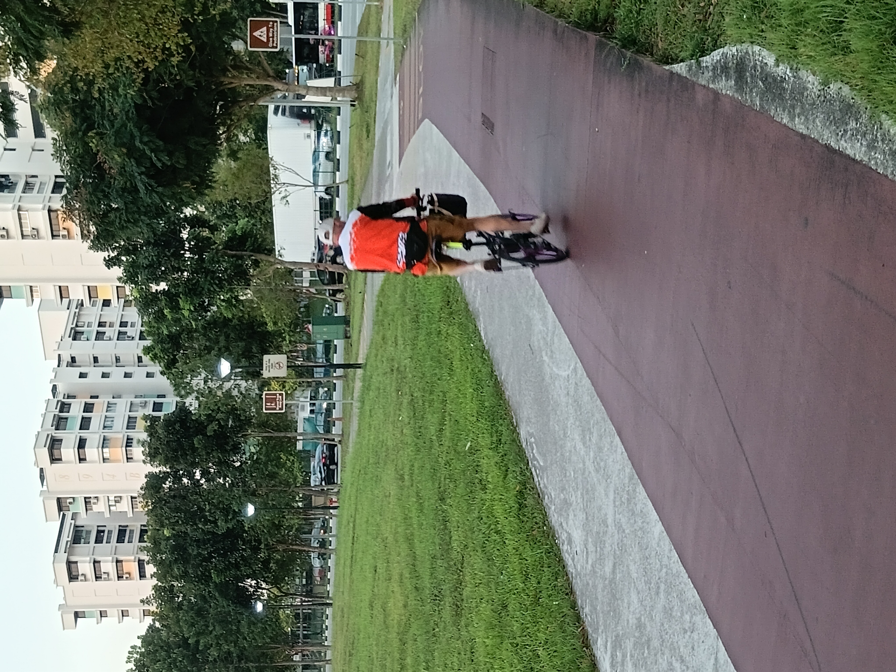
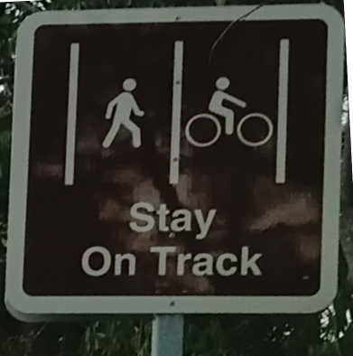
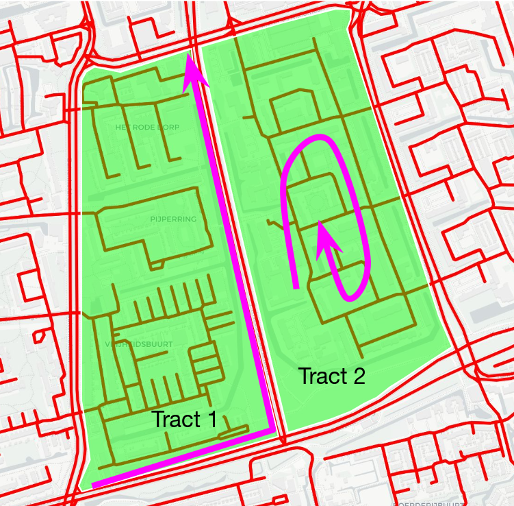
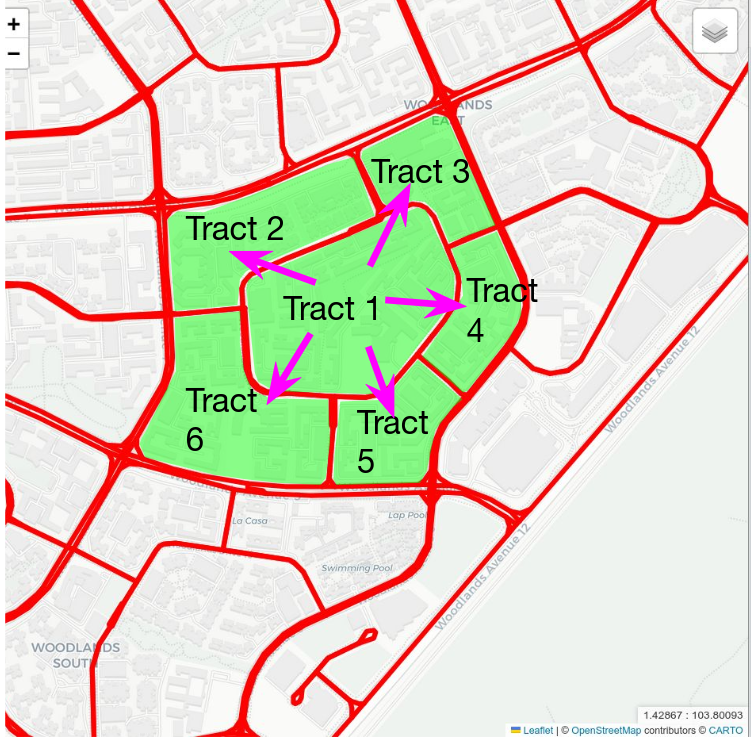
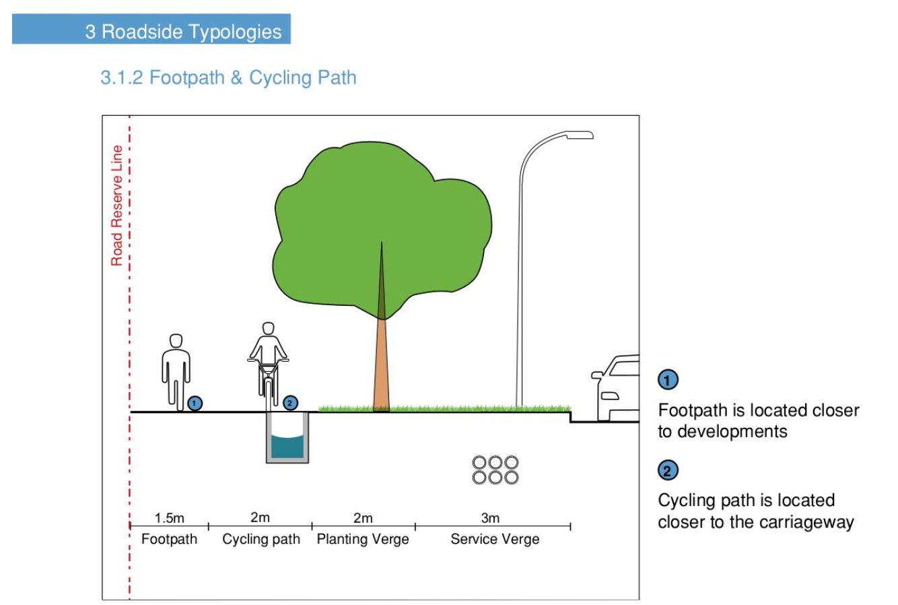

# More Separation for Cyclists in Singapore

If you've lived in Singapore long enough, occasionally you'd have to go somewhere that is (i) not near a train station, (ii) too far to walk, yet (iii) close enough that waiting for the bus takes longer than the bus trip itself. In these cases, I usually prefer to cycle. Cycling's faster than walking, and I get to save time and money from taking the bus. I also enjoy being able to cycling anytime and anywhere, except when it rains. Yet only 1% of trips are made on bicycles.[^1] In my opinion, a significant reason for cycling's low mode share is the lack of separation between bicycles and other modes of transportation.[^2]

Separation, in general, increases safety and speed by (i) dedicating space for a single mode of transport and (ii) by separating travel directions. An example of separation infrastructure is the expressway, where the speed limits are much higher compared to city streets because there are no pedestrians or cyclists to watch out for.[^3] Also, the median divider separates cars travelling in opposite direction so you can drive non-stop save for when there's a traffic jam. Similarly, cycling around a city would be safer and more efficient if there was more infrastructure that separated bikes from other modes, and people cycling in opposite direction.

Separation makes cycling safer by reducing the overall variability in speeds. The more modes share a path, the greater the variability in speed and the higher the risks of collisions. For instance, traffic junctions are more dangerous than expressways because junctions have a mix of pedestrians, cyclists and vehicles travelling at different speeds, while expressways are just for vehicles. The larger the variation in speed, the lesser time someone has to avoid a collision. 

Adding separation infrastructure also makes cycling more efficient. When cyclists know that pedestrians might suddenly move into their path, they will typically slow down. If there is low foot-traffic on shared paths, cyclists could sometimes overtake pedestrians but with Singapore's high population density, especially in areas around train stations, overtaking is frustrating for both cyclists and pedestrians. As a final resort, cyclist could move onto the road to go faster but that puts cyclists at risk of getting hit by a car and makes drivers upset at them for taking up the lane. Instead, giving cyclists their own dedicated paths would keep them safe and free them up to go faster.

<em>(Left: Foot and bikepath in Singapore, Right: A sign at the beginning of the path explaining which mode goes where)</em>

Before I go into the practical changes Singapore can make to increase separation for bicycles, I wanted to introduce three categories that I came up that make up a typical cycling trip. Depending on the category, I have a different interpretation of separation and consequently, a different recommendation to increase separation. For the sake of this post, I will be referring to land parcels surrounded by roads as 'tracts'. In general, I think cycling trips can be broken up as a sequence of shorter trips that fall into one of three categories:

**Categories**

1. **Travelling along the perimeter of the tract**: The path along the road, that is usually shared between cyclists and pedestrians. 
   
2. **Travelling across tracts**: The path across an intersection, where there is a mix of cyclists, pedestrians and cars.
   
3. **Travelling within tracts**: The path through a tract, often into a built-up area with mostly pedestrians like university or hospital campus or residential area.

    
    

<em></em>

The left image above shows an example of travelling around and within a tract in Delft (a city known for being extremely bikable). The right image shows an example of travelling across tracts in Singapore (my city, which I think could use better bike infrastructure). I chose to contrast Delft against Singapore to show that these categories are generalisable across cities.

Let's look at the first category, **travelling along the tract perimeter**. My suggestion is to have wider shared paths, to separate cyclists and pedestrians, especially in high density areas like around a train station. Singapore's shared paths are split into foot and cycling paths, which are currently wide enough to only fit two people going in the same direction or one person each going in opposite directions. Based on an interagency design guide, shared paths have widths ranging from 1.8m to 3.5m.[^4] I believe this is not enough space for a country where cars cost upwards of SGD 180,000 (USD 140,000). Based on the current design guide, pedestrians cannot have conversations side-by-side because they would block someone coming towards them or have to step into the cycle path. 

*(Above: "[Walking and Cycling Design Guide (2018)](https://www.lta.gov.sg/content/dam/ltagov/industry_innovations/industry_matters/development_construction_resources/pdf/ActiveMobilityProposalsandRequirements/Walking%20Cycling%20Design%20Guide%20SG.pdf)", p.44)*

{:.table}
| Path | Width                             |
|-----------------------------|-------------------------------------|
|Single Lane Footpath| $1.5\text{m}$|
|Single Lane Cycling Path|$2.0\text{m}$|
| Proposed <u>Low</u> Density Path for Bike & Pedestrian (Single)                         | $1.5\text{m} + 2.0\text{m} = 3.5\text{m}$ |
| Proposed <u>High</u> Density Path for Bike & Pedestrian (Bidirectional)                     | $2 \times (1.5\text{m} + 2.0\text{m}) = 7\text{m}$ |
{:.table}

However, expanding the width of shared paths to encourage separation does come at a land-use cost. The land would have to come from either taking over the planted tree area or shrinking the widths of roads. So, I think a reasonable starting point would be to pilot an increase the width of paths closest to high density and high-foot traffic areas, like train stations or schools. That way, you're not razing every share path to have the same expanded length. With sufficient resources, one way to go about it would be to study the foot and bike traffic flow levels in neighbourhoods and assign appropriate path widths to serve as many people while minimising land-use that could be used for other purposes.

Now, we turn our attention to ‘**travelling across tracts**’. A solution to make it easier to cycle across tracts is to have dedicated cycling routes that go above or underground from the road level. At Clarke Quay, there's an underpass makes it easy for cyclists to cross the road (Coleman Bridge), because it separates cyclists from the road level. How seamless could travel be if there were similar underpasses at every intersection? Nice idea to dream about, but much of the digging around residential areas is infeasible due to underground cables and pipes. Perhaps when civil engineering gets more advanced, we can come back to creating under or overpasses. 

Another more complex but more effective way to separate bicycles from other modes at intersections is to have alternative routes. Travelling across an intersection is only necessary when pedestrians and cyclists travel alongside cars on roads, and thus are forced to conform to traffic light signals. Instead, an alternative to using traffic junctions are alternative routes like trail corridors. Granted, it is difficult to plan for such alternative routes given land-use constraints, but it has been done in both Singapore and Delft.

    <iframe src="https://www.google.com/maps/embed?pb=!4v1785858723921!6m8!1m7!1sDgA5XacZ2XlCVzxzyObmGA!2m2!1d51.98037986901382!2d4.422528865636337!3f297.53647717657066!4f-9.726059645848935!5f0.4000000000000002"  width="600"
    height="450"
    style="flex: 1; width: 0; height: 100%; border: none;"
    allowfullscreen=""
    loading="lazy"
    referrerpolicy="strict-origin-when-cross-origin">
    </iframe>
    <iframe src="https://www.google.com/maps/embed?pb=!4v1785859277549!6m8!1m7!1sCAoSHENJQUJJaEMwQkFhVDdjOWRERXhNVzYzU2xObWU.!2m2!1d1.297046933054361!2d103.7967522108124!3f313.4214156291778!4f-8.2731431346769!5f0.7820865974627469" width="600"
    height="450"
    style="flex: 1; width: 0; height: 100%; border: none;"
    allowfullscreen=""
    loading="lazy"
    referrerpolicy="strict-origin-when-cross-origin">
    </iframe>

 The picture on the left shows a cycling track in Delft with no cars in sight. The picture on the right shows the Rail Corridor, in Singapore, which can bring you from Clementi to Queenstown neighbourhoods. The Rail Corridor does not follow either the MRT tracks or the route that a car would take. Alternative routes, when they exist, make travelling way more seamless because you do not have to make any stops for the traffic light.

The final suggestion I have for adding separation when travelling across tracts is to put more distance between cars and other modes at traffic crossings. In Singapore, during peak hours, cyclists tend to cycle out of the dotted lines to avoid pedestrians but are in danger of getting hit by oncoming traffic. In comparison, the crossings for cyclists in Delft are separated from the cars by a wide patch of grass.

<!-- 1. Intersection Singapore -->

    <iframe src="/img/blog/20260523_SeparationInPlanning/html/intersections/sg_satellite.html" 
    style="flex: 1; width: 0; height: 100%; border: none;">
    </iframe>
    <iframe src="https://www.google.com/maps/embed?pb=!4v1785288036955!6m8!1m7!1sPl6O1rOuM2A60NMGMj366A!2m2!1d1.441568956034579!2d103.8016610669799!3f122.32233904802719!4f-7.503106594056092!5f0.7820865974627469" 
    width="600"
    height="450"
    style="flex: 1; width: 0; height: 100%; border: none;"
    allowfullscreen=""
    loading="lazy"
    referrerpolicy="strict-origin-when-cross-origin"
    >
    </iframe>

<em>(Above:  A four-way stop in Admiralty, Singapore; Below: A four-way stop with more separation between cars and pedestrians in Delft, Netherlands)</em>

<!-- 2. Intersection Delft -->

    <iframe src="/img/blog/20260523_SeparationInPlanning/html/intersections/delft_satellite.html" 
    style="flex: 1; width: 0; height: 100%; border: none;">
    </iframe>
    <iframe
    src="https://www.google.com/maps/embed?pb=!4v1782564433893!6m8!1m7!1sHzmz95aOebFccwFWfKRg-w!2m2!1d51.9891144088233!2d4.358578917553602!3f210.3115105428027!4f-13.472752222841336!5f0.7820865974627469"
    width="600"
    height="450"
    style="flex: 1; width: 0; height: 100%; border: none;"
    allowfullscreen=""
    loading="lazy"
    referrerpolicy="strict-origin-when-cross-origin"
    ></iframe>

&nbsp;
&nbsp;

For my third and last category, **travelling within tracts** , I propose making it easier to travel in and out of the tract. HDB estates in Singapore are elevated to prevent flooding and separate HDB blocks from the street level, but these mounds also restrict cyclists from moving in and out of the tract easily. Cyclist have to carry their bikes up the stairs or use the ramps, which make too many turns. This leaves cyclists with no option but to take the roads into the HDB estate, and puts them next to cars. A better form of separation is to have entrances and exits with slopes for bicycles to travel within tracts. Also, making sure that obstacles within tracts like curbs and drains are designed to allow easier movement for bicycles and even wheelchair users.

<!-- Entering / Exiting Tracts -->

    <iframe src="https://www.google.com/maps/embed?pb=!4v1785861430859!6m8!1m7!1s6E0sI4pBkp1GopxSEPYLyw!2m2!1d52.00036998192179!2d4.34090832683009!3f317.8695576299215!4f-28.991670751662113!5f0.7820865974627469" 
    width="600"
    height="450"
    style="flex: 1; width: 0; height: 100%; border: none;"
    allowfullscreen=""
    loading="lazy"
    referrerpolicy="strict-origin-when-cross-origin">
    </iframe>
    <iframe src="https://www.google.com/maps/embed?pb=!4v1785861368450!6m8!1m7!1sQcZdQ3t4C3yY5umd1XhG0A!2m2!1d1.444301341967016!2d103.8029808317048!3f263.31448882693525!4f-7.148336128310262!5f1.726577511819678" width="600"
    height="450"
    style="flex: 1; width: 0; height: 100%; border: none;"
    allowfullscreen=""
    loading="lazy"
    referrerpolicy="strict-origin-when-cross-origin">
    </iframe>

 

The left street view above shows a residential area (Molenbuurt), in Delft, that seamlessly transitions into a no-car area from the road level. On the right are HDB flats in Woodlands Crescent. If I cut through this tract of HDB flats, I can spend less time travelling than if I were to go around the tract. But there is a mound separating the street level from the block's first level.

So there you have it, as I wondered about the general principles to make walking and cycling more seamless in the city, I've realised that separation is key.

**Thanks** to Dominic Ko, Michelle Ong for reading drafts of this.

# Footnotes

[^1]: [ETH Zürich, *Mobility & Transport in Singapore* (2018), p.14.](https://www.research-collection.ethz.ch/server/api/core/bitstreams/4cb4bb3b-ab16-4358-b2a3-5380084438f7/content)

[^2]: I first came across the concept of <em>'separation'</em> in Susan Handy's book, [*Shifting Gears* (2023)](https://share.google/V3B54ZdijraPsAFGl). 

[^3]: Another example of separation is train tracks, which allow trains to run seamlessly during peak hours because the tracks are built above or underground. Trains also have dedicated track that run in opposite directions.

[^4]: [LTA, URA, *Walking Cyling Design Guide* (2018), page 42 - 44.](https://www.lta.gov.sg/content/dam/ltagov/industry_innovations/industry_matters/development_construction_resources/pdf/ActiveMobilityProposalsandRequirements/Walking%20Cycling%20Design%20Guide%20SG.pdf)